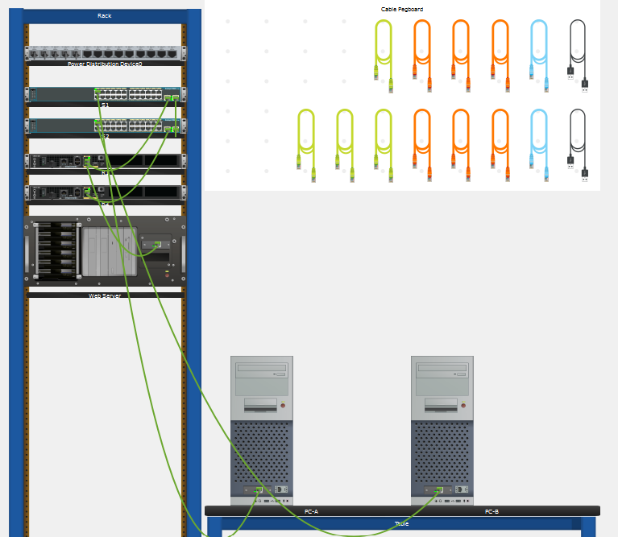
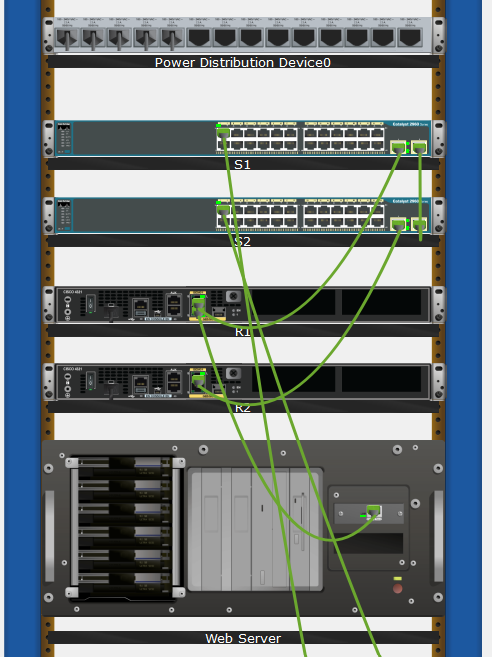
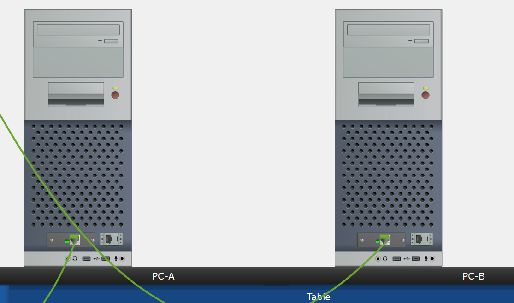

# Lab 01: Connect a Network Based on a Network Diagram

## 1. Aim

To create a physical network topology in Cisco Packet Tracer by connecting routers, switches, PCs, and a web server according to the provided network diagram.

## 2. Objectives

- Understand and interpret a physical network diagram.
- Identify different networking devices and their interfaces.
- Determine the appropriate Ethernet cable for connecting devices.
- Establish physical connections between routers, switches, PCs, and servers.
- Verify that the connections are successfully established.

## 3. Requirements

**Software:**
- Cisco Packet Tracer

**Network Devices:**

| Device | Model / Type | Quantity |
|---|---|---:|
| Router | Cisco 4321 | 2 |
| Switch | Cisco Catalyst 2960 | 2 |
| PC | End Device | 2 |
| Web Server | Server | 1 |
| Ethernet Cable | Copper Straight-Through | As required |

## 4. Network Topology

The network consists of two routers (R1 and R2), two switches (S1 and S2), two PCs (PC-A and PC-B), and one web server.

The devices are interconnected as follows:

- Router R1 is connected to Web Server and Switch S1.
- Switch S1 is connected to PC-A and Switch S2.
- Switch S2 is connected to PC-B and Router R2.

All connections use Ethernet cables.

## 5. Device Connection Table

The following table shows the interfaces used to connect the network devices.

| Device Name | Device Type | Local Interface | Connected Device and Port |
|---|---|---|---|
| R1 | Router / Cisco 4321 | G0/0/0 | Web Server Ethernet NIC |
| R1 | Router / Cisco 4321 | G0/0/1 | S1 G0/1 |
| S1 | Switch / Catalyst 2960 | G0/1 | R1 G0/0/1 |
| S1 | Switch / Catalyst 2960 | G0/2 | S2 G0/2 |
| S1 | Switch / Catalyst 2960 | F0/1 | PC-A Ethernet NIC |
| S2 | Switch / Catalyst 2960 | G0/1 | R2 G0/0/1 |
| S2 | Switch / Catalyst 2960 | G0/2 | S1 G0/2 |
| S2 | Switch / Catalyst 2960 | F0/1 | PC-B Ethernet NIC |
| R2 | Router / Cisco 4321 | G0/0/1 | S2 G0/1 |
| Web Server | Server | Ethernet | R1 G0/0/0 |
| PC-A | PC | Ethernet | S1 F0/1 |
| PC-B | PC | Ethernet | S2 F0/1 |

## 6. Configuration Steps

### Step 1: Review the Network Diagram

- Examine the provided network diagram.
- Identify all networking devices.
- Note the interface numbers of each device.
- Record the connections between devices using the device connection table.

### Step 2: Determine the Cable Type

The devices are connected using Ethernet cables.

**Cable Used:** Copper Straight-Through Ethernet Cable.

In Cisco Packet Tracer, the Copper Straight-Through cable is represented by a green cable.

### Step 3: Connect the Physical Devices

Open Cisco Packet Tracer and switch to Physical Mode.

Connect the devices according to the network diagram.

Perform the following connections:

| No. | Source Device and Port | Destination Device and Port |
|---|---|---|
| 1 | Web Server - Ethernet | R1 - G0/0/0 |
| 2 | R1 - G0/0/1 | S1 - G0/1 |
| 3 | S1 - G0/2 | S2 - G0/2 |
| 4 | PC-A - Ethernet | S1 - F0/1 |
| 5 | PC-B - Ethernet | S2 - F0/1 |
| 6 | S2 - G0/1 | R2 - G0/0/1 |

### Step 4: Verify the Connections

- Check whether all devices are connected to the correct interfaces.
- Inspect the front of the devices to view their port status.
- Check the port LEDs to verify the connection status.
- Green blinking LEDs indicate active network links.

## 7. Verification and Testing

Verify the following:

- All devices are physically connected.
- Correct interfaces are used according to the network diagram.
- Copper Straight-Through Ethernet cables are used.
- Network port LEDs indicate active connections.

**Note:** This practical focuses on physical connectivity. IP addressing and end-to-end communication testing are not part of the provided instructions.

## 8. Result

Successfully established the physical network topology in Cisco Packet Tracer by connecting two routers, two switches, two PCs, and one web server using Copper Straight-Through Ethernet cables according to the given network diagram.

## 9. Conclusion

This practical helped in understanding physical network topologies, identifying device interfaces, selecting appropriate Ethernet cables, and establishing connections between different networking devices using Cisco Packet Tracer.

---

## 10. Screenshots

### 10.1 Complete Network Diagram

### 10.2 Wiring Connections

### 10.3 Verification That Device is Active

<!-- Add a screenshot of your completed Packet Tracer topology here. -->

