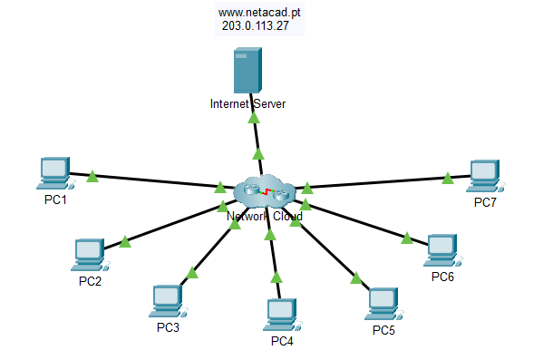
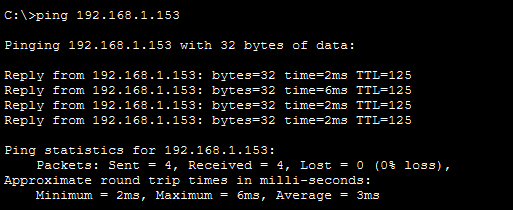
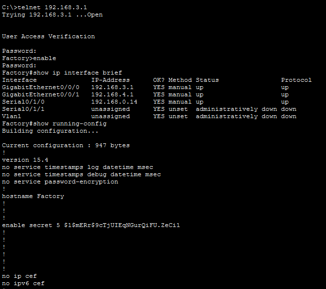
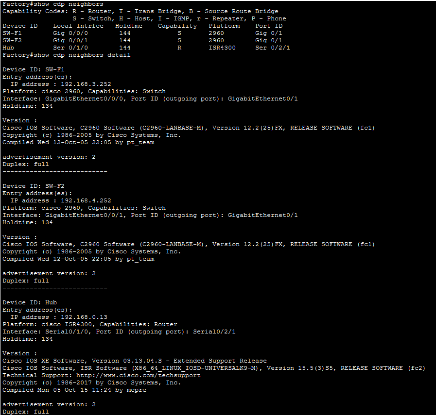
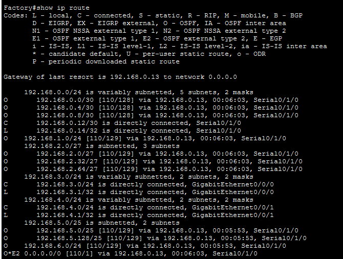

# Lab 02: Troubleshooting Challenge – Using Documentation to Solve Issues

## 1. Aim

To investigate and document an existing corporate network using Cisco Packet Tracer by testing network connectivity, collecting IP addressing information, remotely accessing network devices, discovering network interconnections, and reconstructing the network topology.

## 2. Objectives

- Test network connectivity between PCs and the Internet Server.
- Collect and document host addressing information.
- Remotely access default gateway devices.
- Document default gateway device configurations.
- Discover devices connected to the network.
- Analyze routing tables and neighboring devices.
- Reconstruct and document the network topology.
- Identify network configuration issues and deviations from standard networking practices.

## 3. Requirements

**Software:**
- Cisco Packet Tracer

**Network Devices:**

| Device | Type | Quantity |
|---|---|---:|
| Network Cloud | Cloud Device | 1 |
| PC1–PC7 | End Devices | 7 |
| Internet Server | Server | 1 |

**Network Technologies and Protocols:**
- IPv4 Addressing
- ICMP (Ping)
- Telnet
- CDP (Cisco Discovery Protocol)
- Routing
- Cisco IOS CLI

## 4. Background / Scenario

An organization has hired a new network administrator because the previous administrator has left the company. The existing network documentation is missing and needs to be recreated.

The task is to investigate the corporate network, document all hosts and networking devices, collect IP addressing information, identify logical interconnections, and reconstruct the network topology.

This practical is the first part of a two-part troubleshooting activity. The documentation created in this lab will be used in the second part to troubleshoot network issues.

During the investigation, any network configuration issues or deviations from standard networking practices should also be documented.

## 5. Network Topology

The provided Packet Tracer topology consists of a central Network Cloud connected to seven PCs (PC1–PC7) and one Internet Server.

**Devices in the topology:**

- Network Cloud: Central network representation.
- PC1, PC2, PC3, PC4, PC5, PC6, PC7: End devices connected to the Network Cloud.
- Internet Server: Server connected to the Network Cloud.

**Network Connections:**

The seven PCs and the Internet Server are connected to the central Network Cloud through network links.

**Note:** No individual router is visibly displayed in the provided topology screenshot. However, the lab addressing table contains router information that must be investigated during the activity.

## 6. Network Addressing Table

The following table contains the IP addressing information provided in the lab activity.

| Device | Interface | Device Type | IP Address | Subnet Mask | Default Gateway |
|---|---|---|---|---|---|
| PC1 | NIC | Host | 192.168.1.153 | 255.255.255.0 | 192.168.1.1 |
| PC2 | NIC | Host | 192.168.3.50 | 255.255.255.0 | 192.168.3.1 |
| PC3 | NIC | Host | 192.168.4.115 | 255.255.255.0 | 192.168.4.1 |
| PC4 | NIC | Host | 192.168.5.83 | 255.255.255.128 | 192.168.5.1 |
| PC5 | NIC | Host | 192.168.5.227 | 255.255.255.128 | 192.168.5.129 |
| PC6 | NIC | Host | 192.168.2.48 | 255.255.255.224 | 192.168.2.33 |
| PC7 | NIC | Host | 192.168.2.67 | 255.255.255.224 | 192.168.2.65 |
| Hub | G0/0/0 | Router | 192.0.2.1 | 255.255.255.252 | N/A |
| Hub | S0/1/0 | Router | 192.168.0.1 | 255.255.255.252 | N/A |
| Hub | S0/1/1 | Router | 192.168.0.5 | 255.255.255.252 | N/A |
| Hub | S0/2/0 | Router | 192.168.0.9 | 255.255.255.252 | N/A |
| Hub | S0/2/1 | Router | 192.168.0.13 | 255.255.255.252 | N/A |
| Branch-1 | G0/0/0 | Router | 192.168.1.1 | 255.255.255.0 | N/A |
| Branch-1 | S0/1/0 | Router | 192.168.0.2 | 255.255.255.252 | N/A |
| Branch-2 | G0/0/0 | Router | 192.168.2.33 | 255.255.255.224 | N/A |
| Branch-2 | S0/1/0 | Router | 192.168.0.6 | 255.255.255.252 | N/A |
| Factory | G0/0/0 | Router | 192.168.3.1 | 255.255.255.0 | N/A |
| Factory | G0/0/1 | Router | 192.168.4.1 | 255.255.255.0 | N/A |
| Factory | S0/1/0 | Router | 192.168.0.14 | 255.255.255.252 | N/A |
| HQ | G0/0/0.1 | Router | 192.168.6.1 | 255.255.255.0 | N/A |
| HQ | G0/0/0.5 | Router | 192.168.5.1 | 255.255.255.128 | N/A |
| HQ | G0/0/0.10 | Router | 192.168.5.128 | 255.255.255.128 | N/A |
| HQ | S0/1/0 | Router | 192.168.0.10 | 255.255.255.252 | N/A |
| SW-B1 | VLAN 1 | Switch | 192.168.1.252 | 255.255.255.0 | 192.168.1.1 |
| SW-B2 | VLAN 1 | Switch | 192.168.2.62 | 255.255.255.0 | 192.168.2.1 |
| SW-F1 | VLAN 1 | Switch | 192.168.3.252 | 255.255.255.0 | 192.168.3.1 |
| SW-F2 | VLAN 1 | Switch | 192.168.4.252 | 255.255.255.0 | 192.168.4.1 |
| SW-HQ1 | VLAN 1 | Switch | 192.168.6.252 | 255.255.255.0 | 192.168.6.1 |
| SW-HQ2 | VLAN 1 | Switch | 192.168.6.253 | 255.255.255.0 | 192.168.6.1 |
| SW-HQ3 | VLAN 1 | Switch | 192.168.6.254 | 255.255.255.0 | 192.168.6.1 |

**Note:** The table reproduces the supplied addressing information. Verify the actual device configurations during the practical.

## 7. Practical Implementation

### Part 1: Test Connectivity

The first task is to check whether the PCs can communicate with each other and the Internet Server.

**Steps:**

1. Open each PC in Cisco Packet Tracer.
2. Navigate to Desktop → Command Prompt.
3. Use the `ping` command to test connectivity.
4. Ping other PCs and the Internet Server.
5. Observe and record the responses.

**Command:**

```bash
ping <destination-ip-address>
```

**Example:**

```bash
ping 192.168.1.153
```

**Expected Result:**

All PCs should be able to ping one another and the Internet Server according to the lab instructions.

### Part 2: Discover PC Configuration Information

Collect the IP configuration details from all PCs.

**Steps:**

1. Open the PC.
2. Navigate to Desktop → Command Prompt.
3. Execute the following command:

```bash
ipconfig
```

4. Record the following details:
   - IP Address
   - Subnet Mask
   - Default Gateway
5. Repeat the process for all seven PCs.
6. Compare the collected information with the addressing table.

### Part 3: Discover Information About Default Gateway Devices

In this part, remotely access the default gateway devices using Telnet.

**Telnet Credentials:**

| Credential | Password |
|---|---|
| VTY Password | cisco |
| Privileged EXEC Password | class |

**Steps:**

1. Open the command prompt on a PC.
2. Connect to the default gateway using Telnet.
3. Enter the VTY password.
4. Enter privileged EXEC mode.
5. Examine the router interfaces.
6. Record the interface information.

**Telnet Command:**

```bash
telnet <IP-address>
```

**Cisco IOS Commands:**

```bash
enable
show ip interface brief
show running-config
```

### Part 4: Reconstruct the Network Topology

Investigate the routing tables and neighboring devices to understand how the network is interconnected.

#### Step 1: Access Routing Tables on Each Gateway Device

Use the following command:

```bash
show ip route
```

This command displays the routing table and helps identify:

- Directly connected networks.
- Remote networks.
- Static routes.
- Dynamically learned routes.
- Next-hop addresses.

Record the findings for each router.

#### Step 2: Discover Non-Gateway Devices

Use Cisco Discovery Protocol (CDP) to identify neighboring Cisco devices.

**Commands:**

```bash
show cdp neighbors
show cdp neighbors detail
```

These commands help identify:

- Neighboring Cisco devices.
- Device names.
- Local interfaces.
- Remote device interfaces.
- Device types and capabilities.

Record the discovered information.

#### Step 3: Document Device Interconnections

Use the discovered neighbor information to determine how routers and switches are connected.

Record the connections and prepare a logical network topology diagram.

### Part 5: Further Explore Device Configurations and Interconnections

#### Step 1: Access Device Configurations

Connect to other devices in the network and collect their configuration information.

**Commands:**

```bash
show running-config
show ip interface brief
show interfaces status
```

#### Step 2: View Neighbor Information

Use discovery protocols to gather additional information about network devices and their connections.

**Commands:**

```bash
show cdp neighbors
show cdp neighbors detail
```

#### Step 3: Connect to Other Devices

Access the remaining network devices.

Display their configuration information and record the findings in the device documentation table.

## 8. Important Cisco Commands

| Command | Purpose |
|---|---|
| `ping` | Tests network connectivity. |
| `ipconfig` | Displays PC IP configuration. |
| `telnet` | Remotely accesses network devices. |
| `enable` | Enters privileged EXEC mode. |
| `show ip interface brief` | Displays interface IP addresses and status. |
| `show running-config` | Displays the current device configuration. |
| `show ip route` | Displays the routing table. |
| `show cdp neighbors` | Displays neighboring Cisco devices. |
| `show cdp neighbors detail` | Displays detailed neighbor information. |
| `show interfaces status` | Displays switch port status. |

## 9. Verification and Testing

Verify the following during the practical:

- Connectivity between PCs using ping.
- Connectivity with the Internet Server.
- Correct IP addresses and subnet masks.
- Correct default gateway configurations.
- Successful Telnet access to gateway devices.
- Router interface configurations.
- Routing table information.
- Neighboring devices using CDP.
- Network device interconnections.

## 10. Result

The corporate network was investigated using Cisco Packet Tracer. Host addressing information, network connectivity, device configurations, routing tables, and neighboring devices were examined to prepare network documentation and reconstruct the network topology.

Actual test results and discovered network interconnections should be recorded after completing the activity.

## 11. Conclusion

This practical provides hands-on experience in network discovery, connectivity testing, remote device access, IP addressing, routing table analysis, and network topology reconstruction.

It demonstrates how a network administrator can investigate an undocumented corporate network and prepare technical documentation for future network management and troubleshooting.

---

## 12. Screenshots

### 12.1 Actual Packet Tracer Network Topology



### 12.2 Connectivity Testing



### 12.3 Router Configuration



### 12.4 Network Discovery



### 12.5 Reconstructed Network Topology


